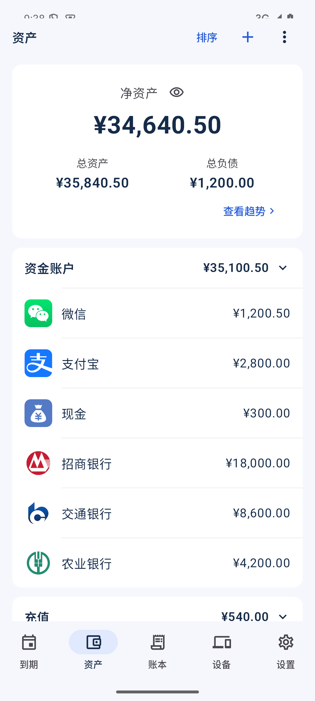
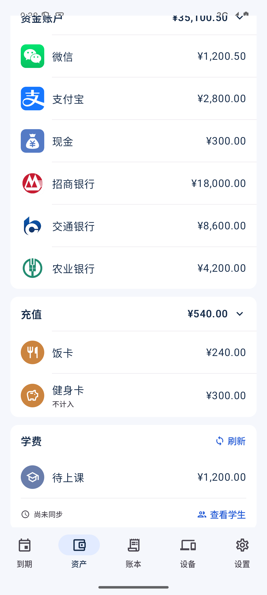

# RenewBoard · 订阅簿

本机优先的中文 Android 订阅与资产管理应用，Android 8.0+。把套餐付款、会员权益和到期日分开管理，也记录账户余额和个人设备的服役状态。默认打开到期页，底部为到期、资产、账本、设备、设置；服务管理从账本右上角进入。

## 界面

下图为 1.14.2 的历史界面示意，使用模拟器虚构演示数据；1.14.3 已调整布局与操作，以下说明以新版为准。首次安装默认为空账本。

 

## 可以做什么

- 到期、资产、账本、设备、设置采用更紧凑的字号与间距。资产页显示净资产、总资产、总负债；下方单列总借入、总借出，点击进入对应账户查看和编辑，分类列表不再重复显示借入款、借出款。右上角三点菜单提供“新增账户”和“显示借入借出”：关闭后隐藏借入借出汇总，并将这两类账户排除出总资产、总负债和净资产，保留余额及各账户原有统计开关，重新开启后恢复；信用卡、贷款、押金不受影响。分类可折叠，长按分类标题或账户行拖拽排序，顺序保存在本机。添加账户先选类型或具体银行，自动命名并复用已有同类型账户；进入详情统一点击“编辑”，可调整名称、分类、余额、日期、币种、折算依据、统计开关和备注，支持纠正上次记录。详情提供删除账户，不再提供归档和趋势入口。支持资金、投资理财、待收款、负债、充值和学费，不要求日常记账。充值保留饭卡、会员卡等，默认不计入，饭卡默认计入，可逐账户调整；话费和 API 平台余额继续在到期与服务管理中管理，不进入资产列表或净资产。外币无手动折算依据时列为待折算，不虚构人民币总额。
- LessonManager 本地记课后手动发布加密学费摘要，手机在“资产 → 右上角菜单 → 学费同步”或首页学费卡片手动刷新。首次选学生，之后按稳定标识更新；学费标题旁的“查看学生”进入学生明细，可本地编辑名称、余额、日期、统计开关和备注；新一期同步会更新余额，相同文件不会覆盖本地编辑，名称和备注保留。预收学费为负债，已上课欠费为应收款，不自动改银行卡余额。客户端 AES-256-GCM 加解密，服务器只保存最新密文；令牌与密钥不进入业务备份。服务端复用已有 OpenResty，须经确认后配置，仓库只提供[接口与部署说明](tools/tuition-relay/README.md)，没有默认在线服务。操作规则见[资产与学费同步](docs/assets.md)。
- 72 项常见会员、服务器、域名与 AI 平台余额快捷选择，支持搜索和最近使用快捷选择；官方应用商店/官网图标，无需网络加载。
- 账本右上角“服务管理”进入全部会员、服务器、域名及余额账户；新增、编辑、归档、删除订阅。列表支持按套餐名称及包含权益搜索、自动续费筛选与排序，已选续费筛选显示可清除标签，排序方式直接可见；从详情返回服务列表，再返回账本；重新进入服务管理保留查询、筛选、排序和滚动位置；归档详情明确停止状态，以恢复使用为主操作。过期项目默认收起。删除后真实付款仍保留在账本。
- 日期选择有独立的年份、月份入口，月份可直接点选，也可逐月切换或回到今天；支持大字体，保留手动输入。金额使用数字键盘，币种通过列表选择。新增先选会员或自定义；保存按钮固定在底部，备注和联合权益默认收起，付款进入独立页面。
- 周、月、年及整数倍周期；自动续费与一次性 / 手动续费。订阅、付款、付款更正、人民币补录、退款、话费操作、平台余额操作与设备表单支持本机草稿，返回时可保留或放弃，保存成功后清除草稿。
- 原始扣款日期作为周期锚点，月末与闰年不逐月漂移。默认权益随扣款日期和周期联动，手动修改后独立计算，可恢复跟随。
- 话费余额账户：当前余额、固定月费与扣费日推算剩余余额和充值提醒；月费计入未来30天预计扣款，打开应用时按设定扣费日补记余额查询日期之后的月费支出；充值保留记录、只增加余额、不重复计支出。充值、余额校准与月费调整进入独立页面，固定保存按钮，保存成功后返回，失败保留输入；充值显示操作后的估算余额。支持历史充值补记，明确选择是否已包含在余额中；余额校准可将减少的差额记作额外扣费。转换已有话费订阅时保留历史付款；详情仅展示最近三笔，点击记录查看详情，通过“全部记录”进入独立历史页面。
- AI 平台余额：DeepSeek、MiMo、OpenAI、Anthropic、Gemini、阿里云百炼、火山方舟、硅基流动，可自定义平台；手动填写当前余额和查询日期。充值计入账本支出，消耗通过“更新余额”记录、不重复记账；可补记历史充值并选择是否同时增加余额。外币充值填写实际人民币金额并冻结。余额账户不按周期扣款、不生成到期权益，也不计入未来30天扣款或月费比较。服务器默认月付、域名默认年付，均可调整周期。
- DeepSeek 余额详情的更多菜单可“连接平台”：在独立页面填写一次 API 密钥，查询成功后绑定当前账户 ID，重命名不影响连接；之后点击余额卡的刷新图标手动查询，也可在到期首页“余额”右侧点击“刷新”，逐个查询未归档且已连接的平台账户；手动账户不查询，部分失败保留对应旧值并提示结果，查询中避免重复请求。总可用余额包含赠金，充值余额与赠金明细默认收起；最近联网查询时间单独显示。仅选账户现有币种，不自动换算；失败保留旧余额、连接和成功时间，刷新不生成账本记录。密钥使用 AndroidKeyStore 加密保存在本机，不进入账本导出、坚果云备份或日志；更多菜单可更换密钥或断开，断开保留余额和付款，换手机后重新连接。不提供后台定时查询，MiMo 及其他平台仍为手动余额。[DeepSeek 官方余额接口](https://api-docs.deepseek.com/zh-cn/api/get-user-balance/)
- 提前续费从原到期日延长，可一次续多期并预览到期日，显示本次实付总额和实际续费时长，未手动填写时按期数合计，手动输入优惠价后保留该金额；过期权益可选从付款日重新开通或补交原周期账单，保存前预览到期日与下次扣款。仅记账和付款更正不改变权益。更正与补录使用固定保存按钮，写入成功后返回；空备注默认收起。原外币付款未补人民币金额时，先补录再继续退款。赠送时长不生成付款。同一订阅、日期和金额相同时提示检查，确认后仍可记账。
- 联合套餐一笔付款对应多项权益，权益分别到期，套餐价格只统计一次。详情使用紧凑权益列表，赠送时长从对应权益菜单添加，显示权益名称与新旧到期日；无效天数就地提示，失败保留输入供重试；付款入口固定底部，最近三笔与全部历史分开查看。
- 紧凑蓝色首页突出最近到期与未来30天人民币预计总额，点击总额按日期查看扣款构成，笔数按预计扣款次数统计；需充值的话费优先显示，健康话费及 API 平台账户统一放在到期事项下方的“余额”区，点击进入对应详情，已归档账户不显示。API 余额保持原币种，不计入预计扣款；外币订阅预计按该订阅最近一次付款的实际折算比例计算，缺少依据时仍显示其余已知人民币总额，并列出待补录订阅。
- 账本以统计概览为首页，显示净支出，可展开查看付款与退款构成；从完整菜单选择七档支出趋势（近30天/3个月/6个月/12个月/按年/5年/全部）、净支出分布和付款明细。净支出分布采用饼图，用引线标注应用图标、名称、金额和占比；有净退款或待补录金额时不显示占比，非正向金额单独列出。点击趋势柱更新分布，明细入口跟随所选时段；点击扇区或标签可查看该应用在所选时段的付款。“最近付款”收进“本月明细”，该入口始终查看当前月，不随趋势选择变化。明细为独立页面，按日期分组。未补录的外币金额单独提示，点击可集中处理当前趋势范围或所选时段的待补录记录，补齐后提示消失。
- 明细支持搜索，通过完整类型菜单筛选订阅付款/平台充值/退款/话费扣费/话费充值/已删订阅，订阅付款排除退款和余额账户记录；支持单笔及批量删除；删除订阅时可选择是否同时删除付款。仅删除付款不会撤销权益或改变账户余额。
- 付款详情的更多菜单可记录全部或部分退款，关联原付款并按退款日期冲减支出；退款不改变权益或账户余额，原付款与关联退款支持双向查看。删除原付款会一并删除关联退款，确认前显示数量。外币退款填写实际人民币到账金额。
- 主栏目分别显示各自内容和保存页面状态；服务管理是独立页面，顶部返回或系统返回回到账本，返回时收起键盘，搜索内容保留。账本切换栏目保留所选范围、日期及滚动位置。页面使用160毫秒的克制淡入，导航与返回立即响应，不保留退出页面。近30天趋势默认展示最近日期，点击显示对应日期、净支出和笔数并更新分布，期间合计保持独立；不自动打开明细。待补录列表显示原币金额及待补笔数，不再显示冗余类型选择；缺失人民币的普通汇总明确标为已知净支出。
- 外币首次付款与续费填写付款当天的人民币实付金额，保存后冻结，后续汇率变化不改历史；付款明细以人民币实付为主、原币为辅。旧外币记录显示待补录，可按当日账单补齐；不按当前汇率倒算。
- 16 类常用设备通过带图标的紧凑网格选择，支持搜索；包含鼠标、椅子、耳机、显示屏、手表、键盘、手柄、电纸书等。
- 设备列表首次默认服役中，通过下拉查看已退役、已卖出和待购买；本次使用中切换栏目保留筛选、搜索、排序与滚动位置，进入详情后返回也保留位置；列表金额明确区分购入金额、已卖出净花费与待购买预算；记录金额、服役日期和备注，退役记录退役日期，卖出记录卖出日期与金额；停止服役早于卖出时展开独立日期，服役时长按停止服役日期冻结。查看服役天数及日均购入成本，已卖出突出扣除卖价后的净花费。支持搜索名称、类别；排序随状态使用服役/退役/卖出/计划日期，以及购入金额、净花费或预算；待购买隐藏服役时长排序；通过“记为已购买”确认实际金额与开始服役日期，保存后转为服役中，保留原设备资料；购买后旧编辑草稿保留名称、类别与备注，状态、金额及服役日期更新为已购买记录，避免再次保存回退。设备金额单独管理，不自动加入订阅支出。
- 设置首页按功能分组；到期提醒、本地备份、坚果云 WebDAV、更新与关于分别进入独立页面。WebDAV 配置后优先显示备份状态、立即备份与云端备份，账号和应用密码收进连接设置。云端备份列表显示本地日期时间及手动/自动类型，按云端文件时间排列，时间未知时明确标注，点击后仍先预览再恢复。
- 默认提前3天及当天提醒，可用快捷选项及自定义天数调整，点击即保存，数据库提交成功后才更新选中状态，失败保留原设置；通知直接打开对应订阅，支持确认扣款或明天提醒。续费、充值或校准后清理已解决事项的旧提醒；过去7天错过的提醒合并补发一次。关闭自动续费仍保留到期提醒；设置同时检查通知权限、应用总开关和到期提醒渠道，可直达相应系统设置；后台备份结果及成功时间实时刷新。遵守系统通知授权、省电与 WorkManager 调度，不保证分钟级提醒。
- 设置的“更新与关于”显示作者 RongGuang233，支持手动检查 GitHub 最新正式版本；应用内下载并显示进度，下载完成后唤起系统安装界面；下载失败后点击重新检查即开始检查，无需重复点击。首次需允许订阅簿安装应用，最终覆盖安装由用户确认；下载仍需能连接 GitHub。
- JSON 文件导出 / 恢复；1.14.0可读取旧备份。包含资产数据的备份使用版本3，需在1.14.0及更新版本恢复；仅含平台余额使用版本2，其余仍为版本1。未完成草稿与所有连接凭据仅保留本机，不包含在账本备份中。坚果云 WebDAV 自动与手动备份。恢复先预览时间、数量，再确认整体替换。

普通订阅的预计扣款不会自动变为付款记录，请实际扣款后选择“记录付款 / 提前续费”。话费采用按月记账：按已设置月费补记，金额并非从运营商获取；余额查询日期之前的历史不倒推，修改月费可选立即、下月或直接选择年月生效，先按旧规则结算，后续按新规则扣费，不重算已记账记录。话费充值在明细中单列、不计支出；平台充值计入支出。没有支付处理、多设备合并或网页同步。

## WebDAV

在“设置 → 坚果云 · WebDAV”中输入 `https://dav.jianguoyun.com/dav/`、账号和坚果云专用应用密码。保存后在线合并变更自动备份，也可点击立即备份。未配置时不上传数据。

- 仅使用远端 `RenewBoard/` 专用目录。
- 上传临时文件 → 下载核验 → MOVE 发布。仅成功自动备份进入最近10份保留范围；手动备份不自动删除。
- 备份包含账本、套餐、权益、付款（含已冻结人民币金额）、资产及余额历史、设备、提醒与已有汇率设置，排除连接账号、密码、令牌和密钥。
- 密码由 Android Keystore 加密保存在本机，不写日志或导出。
- 云端 JSON 为明文业务备份，经 HTTPS 传输。使用自己的可信 WebDAV 服务。
- 损坏、缺字段、不支持版本或下载失败时不替换本机账本。
- 系统可能延迟后台任务；设置中可看最后成功时间及错误。断开仅清除本机连接，不删除远端备份。

## 构建

JDK 17、Android SDK platform 35 / build-tools 35.0.0，项目自带 Gradle 8.11.1 wrapper。

```sh
export JAVA_HOME=/path/to/jdk17
export ANDROID_HOME=/path/to/android/sdk
./gradlew testDebugUnitTest assembleDebug assembleDebugAndroidTest
ANDROID_SERIAL=emulator-5554 scripts/test-device.sh
```

源码中禁用了 Gradle 隐式 SDK 下载，先通过官方 SDK 工具安装所需组件。本机共用环境路径另见未纳入发布的 `docs/android-environment.md`。

release 签名：

```sh
python3 scripts/create-release-key.py
./gradlew assembleRelease -PsigningProperties="$HOME/Library/Application Support/RenewBoard/signing/signing.properties"
```

该脚本在 macOS 用户应用支持目录创建受限签名文件，重复运行保留已有密钥。不要发布密钥、密码文件、signing.properties 或 local.properties。无签名参数的 release 构建不会冒用 debug 密钥。

测试在独立 debug 包 / 测试数据库执行；设备脚本面向API33+，先运行通知拒绝等测试，再单独运行授权通知测试，最后撤销debug通知权限。正式应用包名 `cn.renewboard`，debug 为 `cn.renewboard.debug`。

## 许可证与隐私

原创代码 MIT；第三方组件保留各自许可证，App 设置中可离线阅读。

- [第三方许可证与兼容性](docs/licenses.md)
- [隐私说明](docs/privacy.md)
- [验收结果](docs/acceptance.md)

产品思路参考[有数鸟开发者2020年历史介绍](https://meta.appinn.net/t/topic/15300)中的快捷录入、到期汇总与费用统计，未声称当前 App 实测，未复制品牌或付费资源。

1.1.0 界面参考 [Suby 订阅列表](https://subyapp.com/features/subscriptions) 的服务目录与到期信息层级，以及 [Subby 设计案例](https://www.mattpercy.com/subby) 的图标识别与次要信息精简。具体应用使用官方应用商店或官网图标，来源见 [图标来源](preview/icons/sources.md)；未指定应用的自定义分类保留 Material 图形。图标不表示与对应品牌有关联。
